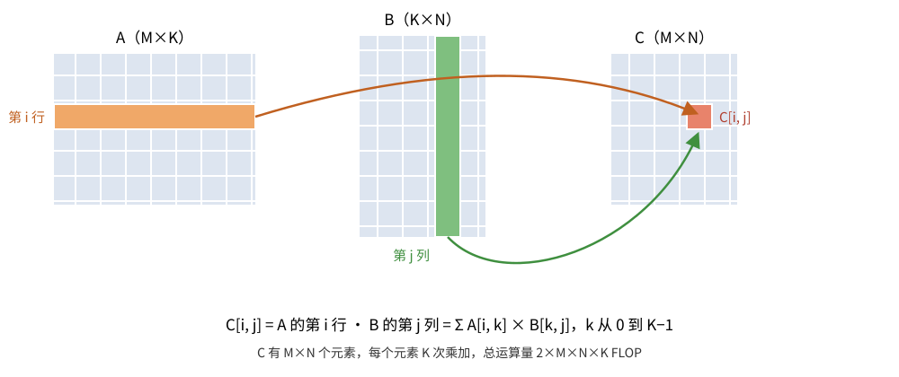

# GEMM —— Tilelang profiling 与性能优化

GEMM：C = A @ B。C 的每个元素要读 A 的一行和 B 的一列，是第一个有数据复用的算子：不做复用，计算被访存拖死；做了复用，性能取决于切分和流水。

这节课的顺序：先写一个故意不做任何优化的朴素版本，用 profiling 工具定位它的瓶颈，再写优化版本回答这个瓶颈，最后调参。

## 朴素版本

先明确 GEMM 在算什么。C 的每个元素是 A 的一行与 B 的一列的点积，沿 K 维累加（图为手写 SVG，`fig_gemm.svg`，可直接改坐标重画）：



`gemm_naive.py` 全文：

```python
import tilelang
import tilelang.language as T

# 朴素 GEMM：不做任何性能优化，作为 profiling 的基线。
# 沿 K 维的循环直接从 global memory 读写，没有 shared memory、没有流水、没有 Tensor Core。
# 累加器也不用寄存器：就是 global memory 里的 C 元素本身。
#
# M、N、K、block_M、block_N 是编译期常量，调用时确定。
# 2048³、block 128×128 是一组配置，换配置就重新编译。
def gemm_naive(M, N, K, block_M, block_N):
    # @T.prim_func：main 不被 Python 执行，被解析成编译器的 IR。
    # 函数体是给编译器读的数据流描述，不是给 GPU 跑的指令流。
    @T.prim_func
    def main(
        # 签名：三个二维 tensor，形状 (M, K)、(K, N)、(M, N)，dtype 都是 float32。
        # 形状和 dtype 是全部类型信息，编译器据此推导访存的类型、宽度、对齐。
        A: T.Tensor((M, K), "float32"),
        B: T.Tensor((K, N), "float32"),
        C: T.Tensor((M, N), "float32"),
    ):
        # T.Kernel 声明归属，两个参数各一层：
        # 第一个参数（二维 grid）：C 切成 (M/block_M) × (N/block_N) 个子块，
        #   切出多少子块就声明多少 block，第 (by, bx) 个 block 负责 C 的第 (by, bx) 个子块；
        # threads=128：每个 block 128 个线程。
        # 本配置下 grid 是 16×16，每个 block 负责 C 的一个 128×128 子块。
        with T.Kernel(T.ceildiv(N, block_N), T.ceildiv(M, block_M), threads=128) as (bx, by):
            # T.Parallel 声明可并行的循环。这里是两层循环 block_M × block_N，
            # 共 128×128 次迭代，摊到 128 个线程上执行——哪个线程跑哪次迭代由编译器推导。
            # 循环体里没有线程概念：i、j 是迭代编号，不是线程编号。
            for i, j in T.Parallel(block_M, block_N):
                # 每个线程负责 C 的一个元素，沿 K 维串行乘加 K 次。
                # T.serial 是普通串行循环：K 次迭代按顺序执行，每次依赖前一次的结果。
                # 累加器就是 global memory 里的 C 元素本身：
                # 每次迭代读 A、B 各一个元素，再对 C 做一次读-改-写，全部访问 global memory。
                for k in T.serial(K):
                    # 索引拆开看：
                    #   by * block_M + i —— block 负责的 C 子块的起始行 + 子块内第 i 行
                    #   bx * block_N + j —— 起始列 + 子块内第 j 列
                    #   k —— 沿 K 维的第 k 次乘加
                    # 整行读作：线程 (i, j) 的第 k 次迭代，
                    # C[by*block_M+i, bx*block_N+j] += A 的第 by*block_M+i 行第 k 列 × B 的第 k 行第 bx*block_N+j 列。
                    # C 元素乘加 K 次后就是点积 A 的第 (by*block_M+i) 行 · B 的第 (bx*block_N+j) 列。
                    C[by * block_M + i, bx * block_N + j] += A[by * block_M + i, k] * B[k, bx * block_N + j]

    return main

if __name__ == "__main__":
    M = N = K = 2048
    # 编译：Parser → IR Builder → Optimization → Codegen → 加载。
    # out_idx=[2] 声明 C 是输出，wrapper 会为 C 分配显存并返回。
    kernel = tilelang.compile(
        gemm_naive(M, N, K, block_M=128, block_N=128),
        out_idx=[2], target="cuda")

    import torch
    a = torch.randn(M, K, device="cuda")
    b = torch.randn(K, N, device="cuda")
    c = kernel(a, b)
    # 正确性校验：L2 范数比。
    # naive 的乘加由 CUDA core（GPU 的通用浮点单元）执行，是完整的 fp32 精度，误差应为 0。
    ref = a @ b
    rel_err = ((c - ref).norm() / ref.norm()).item()
    assert rel_err < 1e-3, rel_err
    print("gemm naive ok: rel_err = %.2e" % rel_err)

    # 计时：预热 3 次去掉一次性初始化开销；
    # CUDA event 在 GPU stream 上打时间戳，只对齐计算时间（launch 是异步的）；
    # 测 10 次取均值，去掉时钟噪声。
    for _ in range(3):
        kernel(a, b)
    torch.cuda.synchronize()
    t0 = torch.cuda.Event(enable_timing=True); t1 = torch.cuda.Event(enable_timing=True)
    t0.record()
    for _ in range(10):
        kernel(a, b)
    t1.record(); torch.cuda.synchronize()
    ms = t0.elapsed_time(t1) / 10
    # TFLOPS = 运算量 / 时间。GEMM 运算量是 2×M×N×K。
    tflops = 2 * M * N * K / (ms * 1e-3) / 1e12
    print("time: %.3f ms, %.2f TFLOPS" % (ms, tflops))
```

运行：

```
$ python gemm_naive.py
gemm naive ok: rel_err = 0.00e+00
time: 26.598 ms, 0.65 TFLOPS
```

rel_err 为 0：乘加由 CUDA core（GPU 的通用浮点单元）执行，是完整的 fp32 精度，累加顺序和 torch 参考一致。

0.65 TFLOPS 处于什么水平、慢在哪里，是 profiling 要回答的问题。

## 计时方法：CUDA event

计时这一段是通用的测量方法，先讲清楚它。

```python
for _ in range(3):  # 预热
    kernel(a, b)
torch.cuda.synchronize()
t0 = torch.cuda.Event(enable_timing=True); t1 = torch.cuda.Event(enable_timing=True)
t0.record()
for _ in range(10):
    kernel(a, b)
t1.record(); torch.cuda.synchronize()
ms = t0.elapsed_time(t1) / 10
```

三个设计，每个都针对一个测量陷阱。

预热 3 次。第一次调用有 lazy 初始化：CUDA context、torch 句柄、TileLang 编译产物的首次加载。这些开销只发生一次，算进均值会污染测量。预热之后再开始计时。

CUDA event 而不是 wall clock。`t0.record()` 和 `t1.record()` 在 GPU 的 stream 上插入两个时间戳，GPU 执行到各自位置时记下时间。`t0.elapsed_time(t1)` 取差值。kernel launch 是异步的：host 端 `kernel(a, b)` 返回时 GPU 还没算完，wall clock 测的是 launch 开销不是计算时间。event 的时间戳在 GPU 侧，只对齐计算。结尾的 `torch.cuda.synchronize()` 保证 t1 的时间戳被写下之后再读。

测 10 次取均值。单次测量有噪声：时钟波动、调度器抖动。naive 一次 26.6 ms，10 次共 266 ms，噪声被平均掉。

TFLOPS 的换算：

```python
tflops = 2 * M * N * K / (ms * 1e-3) / 1e12
```

GEMM 的运算量是 2×M×N×K：C 的每个元素有 K 次乘加。2048³ 是 1.72×10^10 次 FLOP。除以秒数得到 FLOPS，除以 1e12 得到 TFLOPS。用 TFLOPS 而不用毫秒的原因：毫秒只能在 M、N、K 相同的情况下比大小，换了规模就没法比；TFLOPS 是单位时间的运算量，不同规模的 kernel 都能拿去和这张卡的峰值比。

## Profiling：定位瓶颈

0.65 TFLOPS 的瓶颈在算力还是访存。这个问题分三层测，每层用一个工具，逐层缩小范围：

- 应用层计时：CUDA event。回答"多久"，上一节已经讲过。
- 时间线：nsys。回答"时间花在哪个活动上"——kernel、拷贝、同步、host 开销各占多少。
- kernel 内部：ncu，或它的替代方法流量核算。回答"kernel 为什么慢"——计算吞吐和访存吞吐哪个先到顶。

### 第一层：nsys 看时间结构

nsys 在进程上包一层，记录每次 GPU 活动（kernel launch、memcpy、同步）的起止时间，存成 `.nsys-rep` 报告文件：

```
$ nsys profile -o prof python gemm_naive.py
$ nsys stats --report cuda_gpu_kern_sum prof.nsys-rep
```

`cuda_gpu_kern_sum` 按 kernel 汇总：占总时间的百分比、调用次数、平均时长。naive 的结果：

```
 Time (%)  Total Time (ns)  Instances    Avg (ns)   Name
    99.2        343766732         14   24554766.6   main_kernel
     0.7          2477245          1    2477245.0   ampere_sgemm_64x64_nn
     0.0           152098          1     152098.0   vectorized_elementwise_kernel...
```

读法：

- `Time (%)` 是这一行占总 GPU 时间的比例。`main_kernel`（TileLang 生成的 kernel）占 99.2%，时间全部花在计算 kernel 内部，host 侧没有可挖的东西。
- `Instances` 和 `Avg`。14 次调用的平均 24.6 ms 与 CUDA event 测的 26.6 ms 一致——两种计时方法互相印证。
- 其余行是 torch 的参考计算和校验：`ampere_sgemm_64x64_nn` 是 cuBLAS 的 fp32 GEMM（`a @ b`），单次 2.478 ms ≈ 6.9 TFLOPS，是这张卡 fp32 CUDA core 的实际算力参照。

第一层结论：时间都在 kernel 里，且 naive 的 0.65 TFLOPS 离算力参照差 11 倍——慢的原因要到 kernel 内部找。

### 第二层：ncu 看 kernel 内部

ncu（Nsight Compute）采集性能计数器，给出 kernel 内部的吞吐结构。基本用法：指定 kernel 名、跳过前几次 launch、选要看的报告段。

```
$ ncu -k main_kernel --launch-skip 4 --launch-count 1 \
      --section SpeedOfLight python gemm_naive.py
```

`-k main_kernel` 只采集 TileLang 生成的 kernel；`--launch-skip 4` 跳过前 4 次调用（计时循环之外还有预热，跳过的都是同一 kernel，采哪次结果相同）；`--launch-count 1` 只采一次（计数器采集会重放 kernel，多采很耗时）。

`SpeedOfLight` 段是定位瓶颈的核心，三个吞吐率：

- `Compute (SM) Throughput`：计算单元（CUDA core、Tensor core 加权）的忙碌百分比。
- `Memory Throughput`：整个存储子系统（L1/L2/DRAM 加权）的忙碌百分比。
- `DRAM Throughput`：显存带宽的占用百分比。

判断规则：三者里谁最接近 100%，瓶颈就是谁。计算接近 100% 是受算力限制，继续优化指令；访存接近 100% 是受访存限制，继续优化数据搬运；都低则是受延迟限制——单元都在等数据，要提高占用率或增加指令级并行。

在这台机器上，ncu 报权限错误：

```
==ERROR== ERR_NVGPUCTRPERM - The user does not have permission to access
NVIDIA GPU Performance Counters on the target device 0.
```

性能计数器默认只对管理员开放；启用需要设置内核模块参数 `NVreg_RestrictProfilingToAdminUsers=0` 并重新加载驱动。没有管理员权限的机器上 ncu 不可用，下一节是它的替代方法。

### 第二层（替代）：流量核算

没有计数器时，瓶颈可以从代码静态算出来。方法：数出 kernel 的访存请求总量，除以实测时间，得到请求到达速率，和硬件带宽对比。速率贴近带宽瓶颈就在访存；远低于则不是。

对 naive 算账。每个线程 2048 轮迭代，每轮 2 个 load（A、B 各一个元素）加 C 的一次读-改-写（1 load + 1 store），4 次访问 × 4 B = 16 B，共 32 KB。线程总数 2048² = 4.19 M，总请求量 134 GB，26.6 ms 跑完，请求的到达速率 5.0 TB/s。而最低限度的数据只有 A、B 各读一次加 C 写一次：每张 2048² 的 fp32 是 16.8 MB，合计约 50 MB。naive 的访存请求量是这个最低值的 2700 倍左右。

5.0 TB/s 远超这张卡 256 GB/s 的显存带宽，大部分请求只能被 L1/L2 接住，瓶颈落在存储子系统的请求吞吐上，而不是计算单元。更细的形态：每轮迭代的 A、B load 和 C 的读-改-写都依赖前一轮的结果，构成串行依赖链；硬件靠同时驻留大量线程藏延迟，而每轮 4 次 global 访问的请求量已经把 L1/L2 的吞吐占满，线程再多也没有多余的请求带宽。

结论：naive 被访存拖死，不是被算力拖死。优化方向由此确定：把复用做进 shared memory，把沿 K 维的串行乘加拆成片上小矩阵乘。

### 流程总结

三层各自回答一个问题，层层收窄：

- CUDA event：多久。选测量方法（预热、event、均值）。
- nsys：时间花在哪个活动上。确认优化对象是 kernel 本身，并拿到算力参照（cuBLAS 的时长）。
- ncu 或流量核算：kernel 内部谁到顶。确定瓶颈类型，推出优化方向。

每层的输出是下一层的输入：event 测出 26.6 ms → nsys 确认全在 main_kernel → 核算确认访存是瓶颈 → 优化搬运。这个流程对任何 kernel 通用，不依赖 TileLang。

## 优化版本

`gemm.py` 全文：

```python
import tilelang
import tilelang.language as T

# GEMM：C = A @ B，全部用 TileLang 的 tile 算子描述
#
# 切分决策（性能来源，程序员给出）：
#   C 切成 (M/block_M) x (N/block_N) 个 tile，每 tile block_M x block_N
#   每个 tile 内部沿 K 维再切 block_K，一次只搬一个 K 片
def gemm(M, N, K, block_M, block_N, block_K, num_stages):
    @T.prim_func
    def main(
        A: T.Tensor((M, K), "float32"),
        B: T.Tensor((K, N), "float32"),
        C: T.Tensor((M, N), "float32"),
    ):
        # 归属声明：一个 block 负责 C 的一个 block_M x block_N 子块
        with T.Kernel(T.ceildiv(N, block_N), T.ceildiv(M, block_M), threads=128) as (bx, by):
            # 显式内存放置：buffer 放在哪一层，这个决策也是程序员的
            # A/B 的当前 K 片放在 shared memory（快，block 内共享）
            A_shared = T.alloc_shared((block_M, block_K), "float32")
            B_shared = T.alloc_shared((block_K, block_N), "float32")
            # 累加器放在寄存器 fragment。
            # fragment：分布在寄存器上的 buffer。C_local 声明为 128×128，但不占一块连续的内存：
            # 它的 16384 个元素按编译器推导的线程映射摊到各线程的寄存器，
            # 128 个线程，每个线程持有 128 个元素，作为该线程的私有累加器。
            # 与 shared memory 的区别：shared 是一块内存，按地址索引、block 内所有线程访问；
            # fragment 没有地址，每个线程只读写分到自己寄存器的那 128 个元素。
            C_local = T.alloc_fragment((block_M, block_N), "float32")

            # 数据流：沿 K 维逐片搬入 -> 片上 GEMM -> 累加
            T.clear(C_local)
            for ko in T.Pipelined(T.ceildiv(K, block_K), num_stages=num_stages):
                T.copy(A[by * block_M, ko * block_K], A_shared)
                T.copy(B[ko * block_K, bx * block_N], B_shared)
                T.gemm(A_shared, B_shared, C_local)
            T.copy(C_local, C[by * block_M, bx * block_N])

    return main

if __name__ == "__main__":
    M = N = K = 2048
    # block_M/N/K 和 num_stages 决定生成物的形态
    kernel = tilelang.compile(
        gemm(M, N, K, block_M=128, block_N=128, block_K=32, num_stages=3),
        out_idx=[2], target="cuda")

    import torch
    a = torch.randn(M, K, device="cuda")
    b = torch.randn(K, N, device="cuda")
    c = kernel(a, b)
    # T.gemm 的乘加由 Tensor Core 执行，指令把 fp32 输入截断成 TF32（尾数 10 位），相对误差约 5e-4。
    # 按相对误差（L2 范数比）校验，比逐元素 allclose 适合
    ref = a @ b
    rel_err = ((c - ref).norm() / ref.norm()).item()
    assert rel_err < 1e-3, rel_err
    print("gemm ok: rel_err = %.2e" % rel_err)

    for _ in range(3):  # 预热
        kernel(a, b)
    torch.cuda.synchronize()
    t0 = torch.cuda.Event(enable_timing=True); t1 = torch.cuda.Event(enable_timing=True)
    t0.record()
    for _ in range(10):
        kernel(a, b)
    t1.record(); torch.cuda.synchronize()
    ms = t0.elapsed_time(t1) / 10
    tflops = 2 * M * N * K / (ms * 1e-3) / 1e12
    print("time: %.3f ms, %.2f TFLOPS" % (ms, tflops))
```

运行：

```
$ python gemm.py
gemm ok: rel_err = 7.75e-04
time: 1.754 ms, 9.80 TFLOPS
```

1.754 ms，比 naive 的 26.6 ms 快 15 倍，比 cuBLAS fp32 参照（2.478 ms）也快。优化版的 kernel 平均 1.749 ms（nsys 测），两种计时方法一致。

两行输出：第一行是正确性判定，下一节展开；第二行是计时，方法前面已经讲过。

## 程序结构：五行数据流

优化版回答 profiling 找到的瓶颈：访存没有复用。它的回答是两层切分加显式内存放置。kernel 描述里和性能相关的只有两类东西：切分参数和流水级数。

切分是两个层次的：

- C 的切分：C 是 M×N，切成 (M/block_M) × (N/block_N) 个 tile，每 tile block_M×block_N。`T.Kernel` 的第一个参数声明这个二维 grid，block (bx, by) 负责 C 的第 (by, bx) 个 tile。这是 block 级并行。
- K 的切分：累加维切成 K/block_K 个片。block 一次只搬一个 K 片进片上存储，对这一片做矩阵乘并累加，然后换下一个 K 片。A 的一个 block_M×block_K 片在这一列 tile 间复用，B 的一个 block_K×block_N 片在这一行 tile 间复用，复用都在 shared memory 里完成。naive 里每线程每轮 4 次 global 访问，变成每 block 每 K 片只搬 32 KB、供 128 个线程算同一个 128×128 子块，A、B 的读请求降到原来的 1/128。

切分参数 block_M=128、block_N=128、block_K=32、num_stages=3 是程序员的决策，直接决定生成物的形态和性能。

然后是显式内存放置，这是 TileLang 对 Triton 的关键区别：

```python
A_shared = T.alloc_shared((block_M, block_K), "float32")
B_shared = T.alloc_shared((block_K, block_N), "float32")
C_local  = T.alloc_fragment((block_M, block_N), "float32")
```

buffer 在硬件存储层次的哪一层，程序员声明，编译器不猜。A/B 的当前 K 片放 shared memory：延迟低，block 内线程共享，复用在这里发生。累加器 C_local 放寄存器 fragment：C_sub 的 128×128 个元素摊到 128 个 thread，每个 thread 持有 128 个，沿 K 维的 64 次迭代只读写寄存器。

数据流五行：

```python
T.clear(C_local)
for ko in T.Pipelined(T.ceildiv(K, block_K), num_stages=num_stages):
    T.copy(A[by * block_M, ko * block_K], A_shared)
    T.copy(B[ko * block_K, bx * block_N], B_shared)
    T.gemm(A_shared, B_shared, C_local)
T.copy(C_local, C[by * block_M, bx * block_N])
```

三个 tile 算子。`T.copy` 搬运（global → shared、shared → global）；`T.gemm` 在片上对两个 shared 片做矩阵乘、结果累加进 fragment；`T.clear` 初始化累加器。沿 K 维的循环是"搬一片、算一片"。循环体里没有线程、没有地址展开、没有同步——这些全在生成物里。

注意五行数据流里没有任何性能机制。流水、异步拷贝、向量化、Tensor Core 指令，都不在这五行里。这是 TileLang 编程的中心事实：性能不由数据流代码决定，由切分参数和调度声明决定。profiling 和调参才有明确的操作对象——四个数字。

## 正确性判定：相对误差

```python
ref = a @ b
rel_err = ((c - ref).norm() / ref.norm()).item()
assert rel_err < 1e-3, rel_err
```

校验不用逐元素 allclose，用 L2 范数比，原因在精度上。`T.gemm` 的乘加由 Tensor Core 执行，指令把 fp32 输入截断成 TF32：尾数只有 10 位，每次乘加都损失精度，2048 次累加后逐位对不上参考值是常态。实测 rel_err = 7.75e-04，量级 1e-4，和 TF32 的精度一致。naive 的 rel_err 是 0，因为它的乘加由 CUDA core 执行，是完整的 fp32 精度。

判据是 `< 1e-3`：比实测值大一个数量级，给 M、N、K 增大后误差上升留余量，又不宽到放过真错误。逐元素比较在这里不适用：TF32 的误差分布在整个张量上，L2 范数比正好度量整体偏差。

这条 assert 也是调参的前提。改切分参数会改变累加顺序和指令路径，误差随之变化。每个候选配置都要过同一个判定，调参才有纪律。

## 性能从哪来：读生成物

描述五行，生成物 137 行 CUDA（`kernel.get_kernel_source()`）。性能不在描述里，在生成物里。读三处。

搬运是异步的，且做了向量化：

```cpp
tl::cp_async_gs<16>(...);   // 全局 -> shared 的异步拷贝，每次 16 字节
tl::cp_async_commit();
tl::cp_async_wait<2>();     // 等最旧的一级流水
__syncthreads();
```

`cp_async` 不经过寄存器，直接把 global memory 的数据写进 shared memory，搬运因此可以和计算重叠。`num_stages=3` 变成三份 shared buffer 的轮转，`cp_async_commit` / `cp_async_wait<2>` 是配对的同步：每轮提交一次拷贝，等到只剩最新两级时开始计算对应那级。这些都没写在描述里，是 `T.copy` 和 `T.Pipelined` 的生成规则。

shared memory 的地址里有大量位运算：

```cpp
((float*)A_shared)[(i * 512) + ((threadIdx.x >> 3) * 32) + (... & 1) * 16) + (...)]
```

这是 swizzled layout：写入时把地址按位打散，让同一轮访存的线程落在不同的 memory bank 上，避免 bank conflict。程序员没有指定任何布局，编译器为 `T.gemm` 推导的。

计算由 Tensor Core 执行：

```cpp
tl::mma_sync<tl::DataType::kTensorFloat32, ..., 16, 8, 8, ...>(...)
```

`kTensorFloat32` 即 TF32 指令，16×8×8 是这条 mma 指令一次计算的子块大小，输入 operand 是从 shared 搬进寄存器的 fragment。指令换了，天花板也换了：fp32 CUDA core 的算力参照是 6.9 TFLOPS，TF32 tensor core 的峰值高一个数量级。

这三处合起来解释 9.80 TFLOPS。当前实现离 TF32 峰值还差得远：9.80 只是 128×128×32 切分、128 线程的配置跑出来的结果。切分越大、并行度越高，越接近峰值，但资源占用也越高。这就是后面调参的搜索空间。

## 调参：改四个数字

改 block_M / block_N / block_K / num_stages，重新 compile，生成物跟着变：block_K 减半则 cp_async 的宽度减半；num_stages 加一则轮转模数加一、shared memory 多占一级 buffer。描述五行不变，生成物变。调参的操作成本是几秒一次编译加一次计时。

### 实测

对 2048³ 搜索 7 组参数，每组三步：改参数重新编译、CUDA event 计时（预热 3 次、测 10 次取均值）、过不了 assert 的直接排除：

```
block=(128,128,32) stages=2: 1.748 ms  9.83 TFLOPS
block=(128,128,32) stages=3: 1.762 ms  9.75 TFLOPS
block=(128,128,32) stages=4: FAIL（shared memory 超限）
block=(128, 64,32) stages=3: 1.841 ms  9.33 TFLOPS
block=( 64, 64,32) stages=3: 11.411 ms  1.51 TFLOPS
block=(128,128,64) stages=3: FAIL（shared memory 超限）
block=( 64, 64,64) stages=4: FAIL（shared memory 超限）
```

### 约束关系

失败和性能差异都有确定的原因，从切分参数能直接算出来。

block_M×block_N 决定累加器大小。128×128 的 fp32 fragment 是 64 KB，128 个线程摊到每线程 128 个寄存器，接近每线程 255 个的上限。block_N 再翻倍就装不下，编译器只能把累加器溢出到 local memory，性能崩掉。

block_K×num_stages 决定 shared memory 占用。每级流水要一组 buffer：一份 A 片加一份 B 片，block_K=32 时共 32 KB，三级 96 KB。stages=4 时 128 KB，超过这块卡 99 KB 的动态 shared memory 上限，launch 直接失败。block_K=64 同理，两级就到 128 KB。

两项相加卡死可行域：tile 大则寄存器紧张，流水深则 shared memory 紧张。缩小 tile（64×64）两项都省，但每个 block 的并行度不够：64×64 的 tile 只有 4096 个互相独立的元素，128 个线程分到的独立工作太少，Tensor Core 的并行度用不满，性能掉一个数量级（11.4 ms）。搜索不是单调的——往两个方向走都会撞墙。

### 收益对比

单次迭代几秒：改数字、重编译、计时。同样的过程在手写 CUDA 里是重写 kernel 再 nvcc，以小时计。描述和生成物分离的直接收益：调参改的是声明，不是代码。

## 调优的三个层次

手工调参循环再往上，是两级自动化。三级的结构相同，搜索对象逐级放大：

| 层次 | 搜索对象 | 谁执行 | 正确性保障 |
| --- | --- | --- | --- |
| 手工调参 | block_M/N/K、num_stages 这几个数字 | 人 | 人写断言 |
| TileLang autotuner | 同一套数字的配置空间 | 编译器框架 | 内置校验，并行编译候选 |
| TileFoundry | 整个程序文本 | agent | describe-check-optimize 循环 + L1–L3 分级验证 |

第一级就是上一节的实测。第二级，TileLang 自带 [autotuner](https://tilelang.com/programming_guides/autotuning.html)：把配置空间声明出来，框架并行编译候选 kernel、逐个计时、用参考输出自动校验——手工循环的三个步骤原样保留，只是由框架驱动。

第三级是 tile-ai 团队的 [TileFoundry](https://github.com/tile-ai/TileFoundry)：agentic 的程序生成平台。它解决的问题和 TileLang 同构，但让渡出去的东西多了一层。对照看：

- TileLang 让渡线程代码，保留切分决策；手工调参是人来做这个决策
- TileFoundry 让渡程序本身，保留验证：agent 在 HIR（高级 IR）层描述模型、写优化版本、用 `tilefoundry check` 和参考实现对拍，框架的调度设施（多面体分析、storage-driven 指令选择、带空洞的 kernel 骨架）把"试什么"变成可计算的查询，L1（逐层）/L2（整链）/L3（逐 token 复现官方输出）三级信任标注每个程序验证到什么程度
- 它的设计原则"fail closed, verify explicitly"——check 没有默认容差，误差界由调用方声明——和手工调参里"失败的配置直接排除"是同一个纪律：静默通过不产出任何知识

交叉验证一个判断：三个层次共用的基本单元相同——一次候选程序 + 一次计时 + 一次显式正确性判定。自动化的收益来自把这个单元跑得更多、更广，而不是来自替换它。手工调参一轮几秒、autotuner 一轮并行几百个配置、TileFoundry 一轮是 agent 的一次工具调用（实测记录：Claude Opus 5 自主工作 2.1 小时、177 次工具调用产出 Qwen3-1.7B 的 TileLang 解码实现，单 H200 实测 612 tok/s）。
